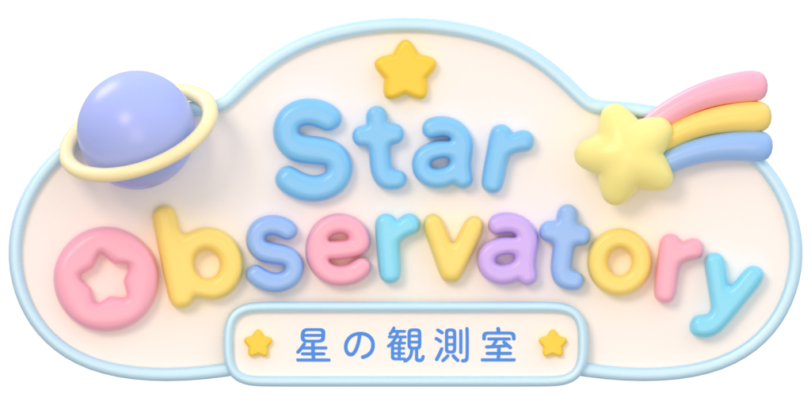
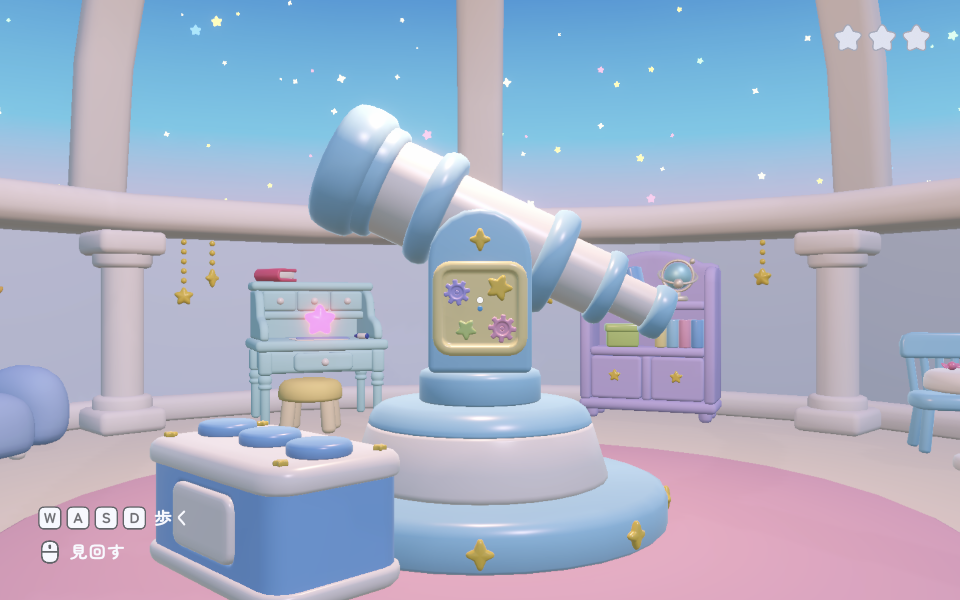
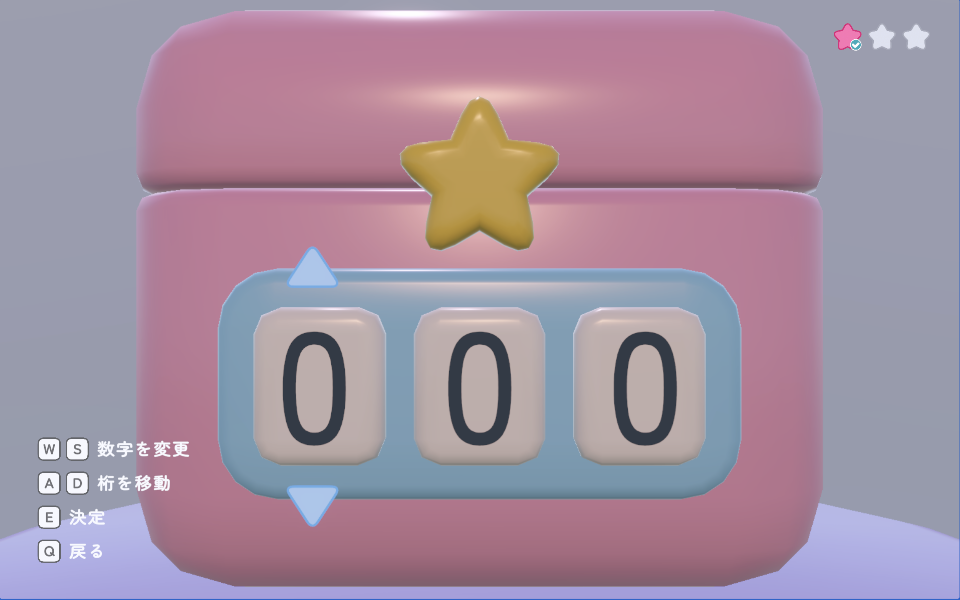
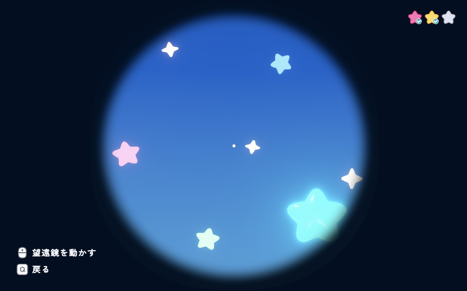

# 星の観測室 - Star Observatory

## 概要

観測室を探索しながら謎を解き、星を集める一人称視点の短編パズルゲームです。

Blenderで制作した3DモデルをUnityに取り込み、ゲーム環境の構築からインタラクション、ゲーム進行、UI表示まで実装しました。

- ジャンル：探索・謎解き
- プレイ時間：約5〜10分
- 制作形態：個人制作
- 公開ページ：[itch.io](https://moruragawa.itch.io/star-observatory)

## 操作方法

| 操作 | 内容 |
| --- | --- |
| W / A / S / D | プレイヤー移動 |
| マウス | 視点移動 |
| E | 調べる・決定 |
| Q | 戻る |

## スクリーンショット

## 使用技術・開発環境

- Blender 5.0
- Unity 6.5
- C#
- CLIP STUDIO

## 主な実装機能

- 一人称視点の移動・視点操作
- インタラクション制御
- ゲームの進行状態管理
- アイテムの取得・配置・所持状態の管理
- 視点の切り替え（通常視点・固定視点・望遠鏡視点）
- UI表示・メッセージ・効果音の制御

## AIの使用

実装方法の調査やC#コードの作成・修正にAIを使用しました。

提案されたコードの内容を確認しながら実装し、Unity上での動作確認・調整をしています。

## 使用素材・クレジット

### BGM

本プロジェクトでは、以下のフリーBGM素材を使用させていただいています。

- すやすやタイム ー Sakuttipanda 様
    - 配布元：[OpenTracks](https://opentracks.com/bgm/detail/23649)
    - 音源ファイルは配布元の利用規約に基づき、Gitリポジトリに含めていません。

#### BGMを有効にする方法

1. 上記配布元ページから音源をダウンロード
2. 音源ファイルを `Assets/Audio/BGM/` に配置

音源が配置されていない場合、BGMは再生されませんがゲームはそのまま動作します。

### SFX

- 効果音ラボ 様
    - 配布元：[効果音ラボ](https://soundeffect-lab.info/)
- Casual Game Sound - One Shot SFX Pack ー Dustyroom 様
    - 配布元：[Unity Asset Store](https://assetstore.unity.com/packages/audio/sound-fx/free-casual-game-sfx-pack-54116)

### フォント

- Zen Maru Gothic
    - 配布元：[Google Fonts](https://fonts.google.com/specimen/Zen+Maru+Gothic)
